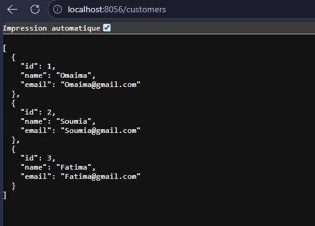
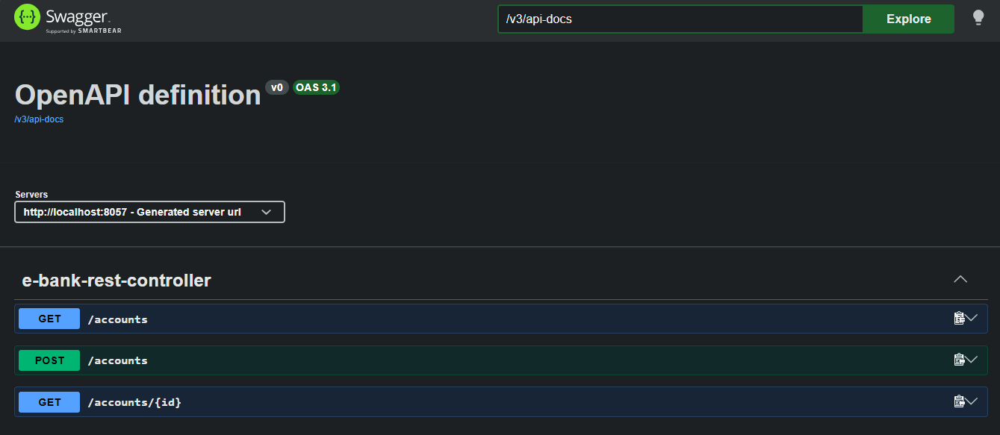
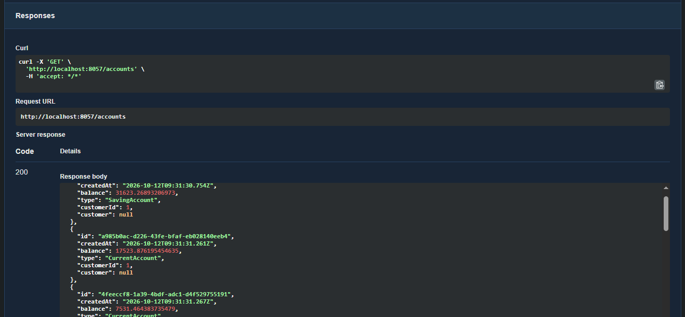
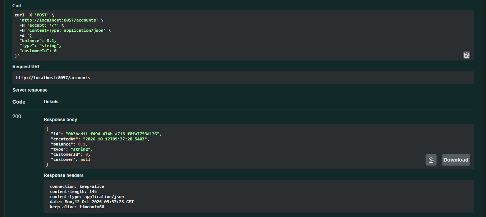
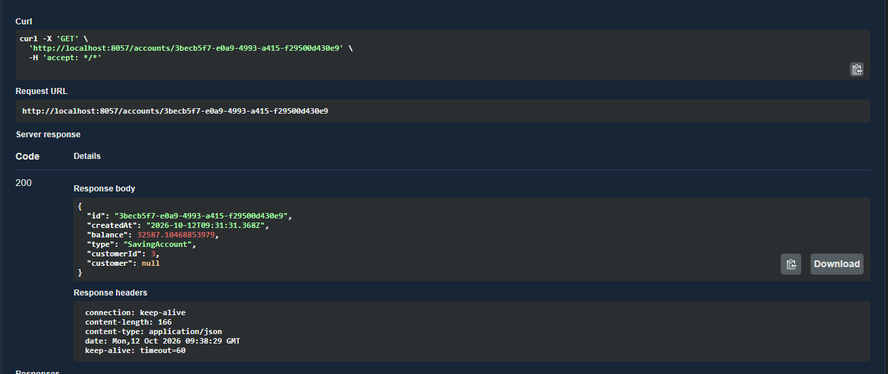
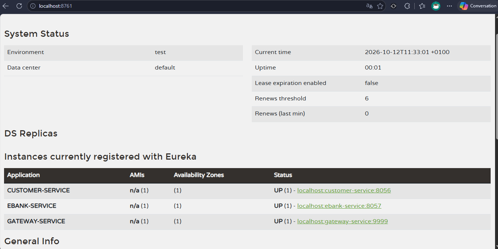

# Projet - Systèmes Distribués
## Partie 1 : Mise en place des microservices

Cette partie porte sur la mise en place des premiers éléments de l'architecture microservices du projet. Elle comprend le développement de Customer-Service et EBank-Service, leur communication avec OpenFeign, ainsi que la configuration de la Gateway et du Discovery Service.

### 1. Customer-Service et EBank-Service

Le service Customer-Service permet de gérer les informations des clients à travers des API REST. Le service EBank-Service permet de gérer les comptes et de récupérer les informations des clients lorsque cela est nécessaire.

Les endpoints des deux services ont été testés.

### 2. Documentation avec Swagger UI

Swagger UI permet de consulter les endpoints disponibles et de tester les API REST directement depuis le navigateur.

### 3. Gateway et Discovery Service

Spring Cloud Gateway sert de point d'entrée pour accéder aux services. Le Discovery Service, basé sur Eureka, permet aux services de s'enregistrer et de se découvrir dynamiquement.

La configuration comprend des routes statiques et dynamiques pour acheminer les requêtes vers les services concernés.

### 4. Communication avec OpenFeign

OpenFeign est utilisé pour établir la communication entre EBank-Service et Customer-Service à travers des appels REST déclaratifs. Cela permet à EBank-Service de récupérer les informations d'un client sans gérer manuellement les requêtes HTTP.

### 5. Gestion des pannes avec Resilience4j

Resilience4j permet de mettre en place le pattern Circuit Breaker pour gérer les échecs des appels entre les services.

Lorsque Customer-Service devient indisponible, le Circuit Breaker peut interrompre temporairement les appels afin d'éviter de répéter les requêtes vers un service en panne, selon la configuration définie.

